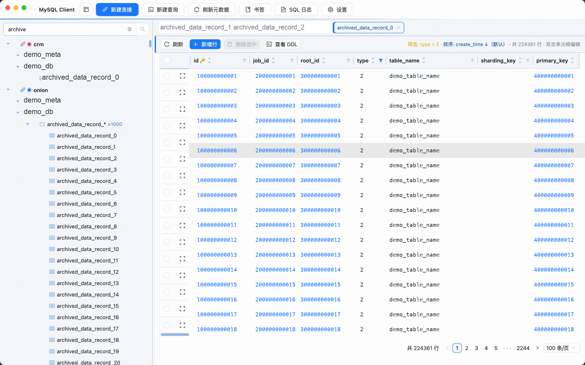
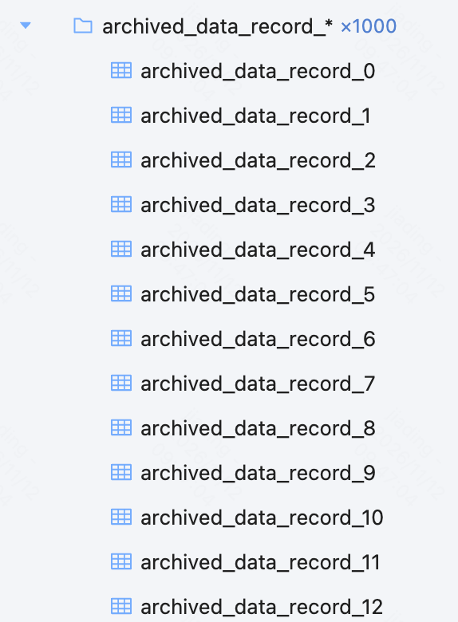
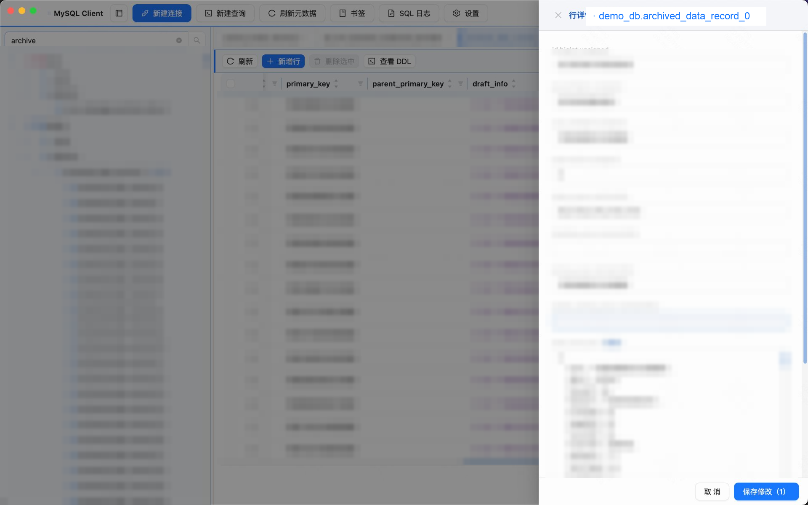
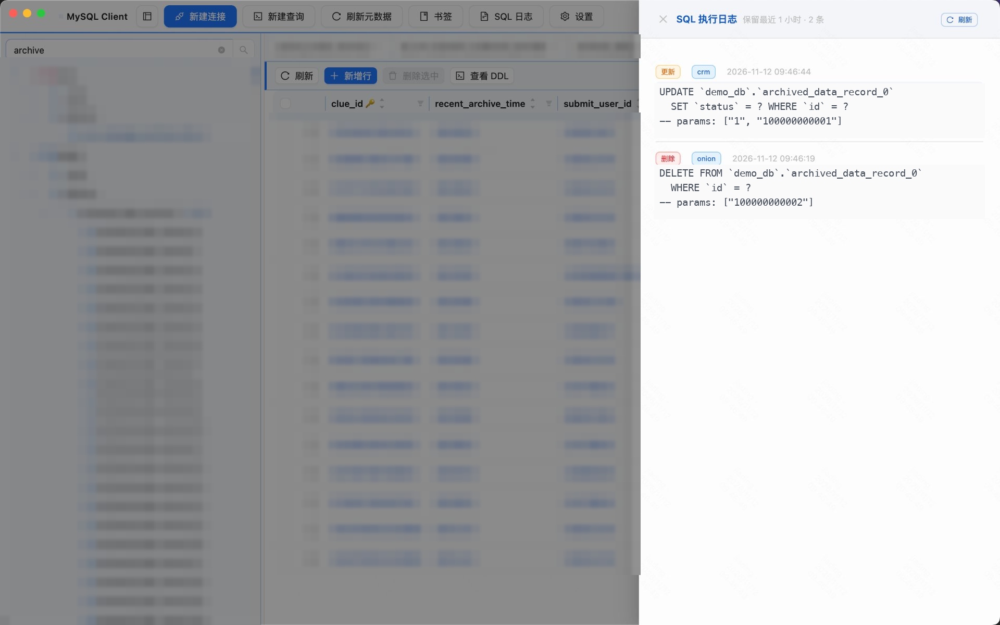
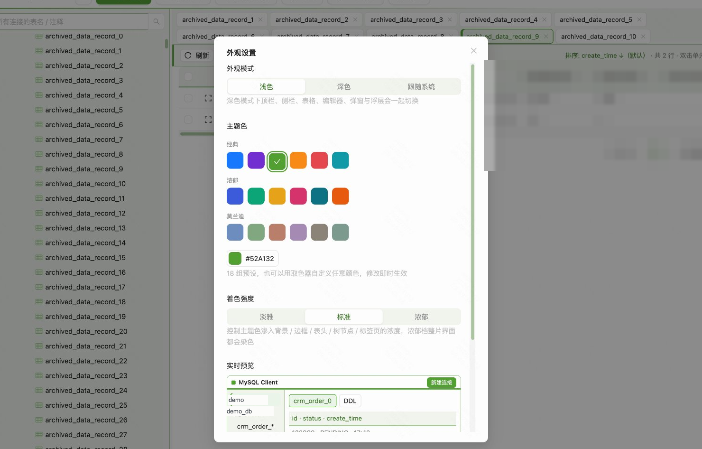
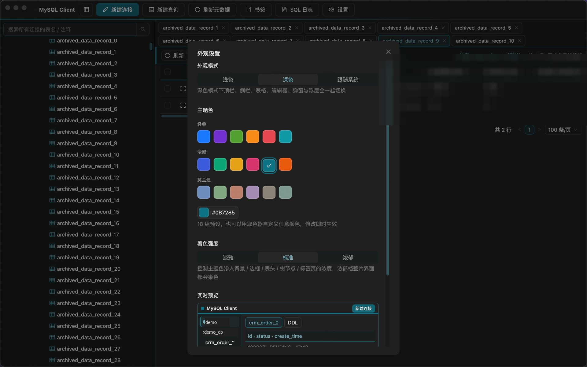
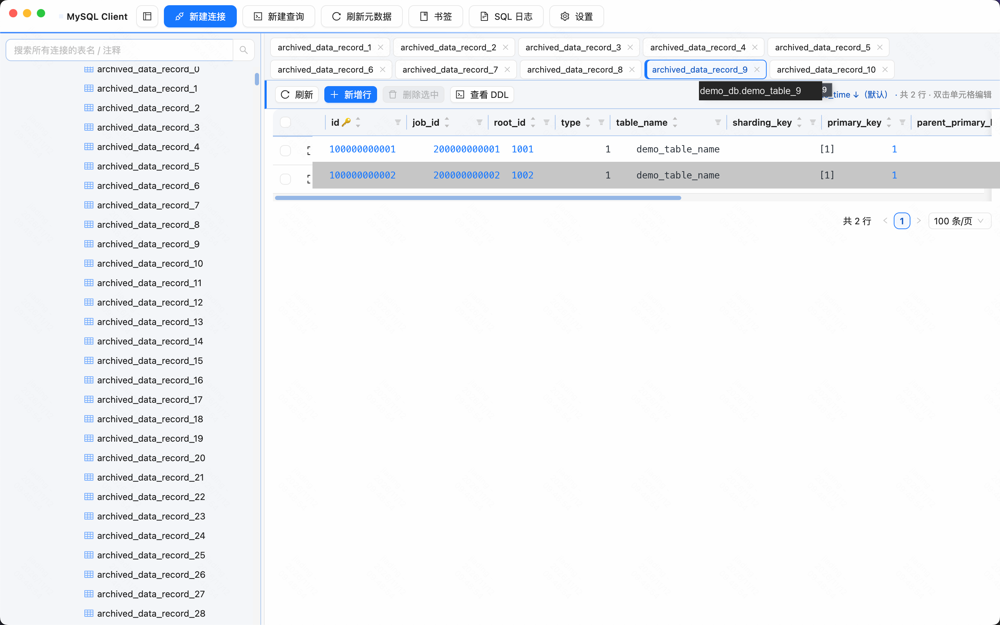
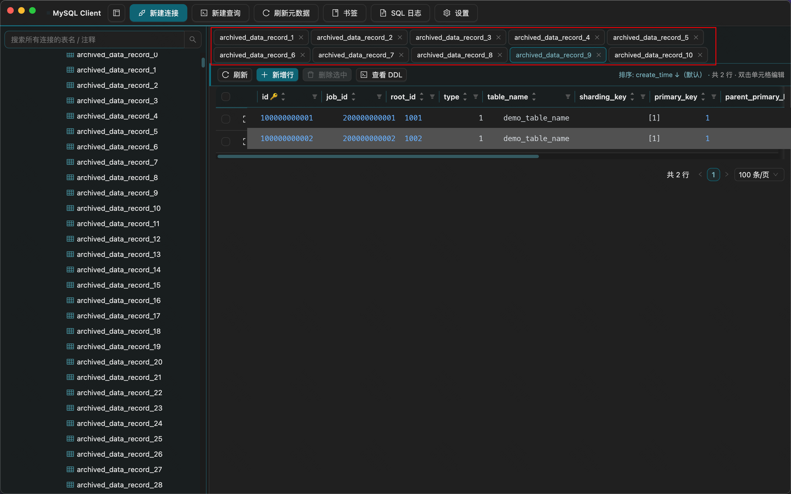

# MySQL Client

macOS 桌面 MySQL 客户端，为「分表多、表数量大、同时开着几个库」的日常查数场景而做。它不打算替代完整的 DBA 工具链，只专注把「找到表 → 看清数据 → 改一行 → 确认改了什么」这段路缩短。

> 一个真实场景：库里有 1000+ 张表，`order_0` 到 `order_63` 这类分表占了大半。通用客户端的树一展开就被同名前缀淹没，找一个表要滚很久；JSON 字段被压成一行看不全，时间戳只是一串数字；改完一行想回看刚才执行了什么，还得翻终端历史。

## 功能一览

| | 能力 | 解决什么 |
| --- | --- | --- |
| 分表治理 | 分表自动折叠 | `order_0..order_63` 收成一个 `order_*` 逻辑组，按数字排序，组内可再展开 |
| | 跨连接搜索 | 输入表名或表注释，所有连接一起找；分表组内的具体分表名也能命中并自动展开 |
| | 上千张表不卡 | 单元格右键菜单全表共用一个实例，数据与总数并行查询，长表名只在实际溢出时才省略 |
| 数据浏览编辑 | 双箭头排序 | 列头两个独立箭头直接升序 / 降序，不用反复点击循环切换 |
| | 漏斗筛选 | 每个列头独立漏斗，数字列默认 `=`、文本默认包含，生效条件在工具栏常驻显示 |
| | 单元格 CRUD | 双击即改，行详情抽屉整行编辑；写 SQL 全部参数化，无主键表自动只读 |
| | 查询与结构 | SQL 查询窗口（⌘+Enter 执行）、DDL 查看、按字段类型着色 |
| 主题与桌面 | 主题系统 | 18 组预设 + 自定义取色 + 浅色 / 深色 / 跟随系统 + 三档着色强度 |
| | 桌面行为 | 无边框窗口拖拽、侧栏保活与拖拽调宽、⌘W 关标签不关窗、LRU 标签页 |



---

## 分表治理

### 一张逻辑组替掉几十张同名表

树里遇到 `_数字` 结尾、同前缀且至少两张的表，会自动归成一个 `order_*` 这样的逻辑组，组内按数字排序。展开组能看到每一张具体分表，右键任意一张可以单独打开、查 DDL、收藏。

标签打在逻辑组上整组生效，不用给 64 张表挨个贴一遍。搜索时输入 `order_17` 也能命中这个组，匹配结果会自动展开到眼前。



### 跨连接搜索

侧栏顶部的搜索框对所有连接生效：输入表名、分表组内成员名或表注释，所有库一起过滤，命中的连接与库会自动展开。搜索过程中缺少的库表元数据会按需补齐，不需要先手动把每棵树点开一遍。

### 表多的时候仍然跟手

- 全表只挂一个右键菜单实例、一个悬停预览浮层，而不是给每个单元格各挂一个组件；100 行 × 20 列也不会拖慢渲染。
- 表数据与总数并行查询，默认分页 100 行。
- 超长表名占满侧栏可用宽度，只有真正溢出时才省略，鼠标悬停可看全名。
- 侧栏隐藏时保留滚动位置与展开状态，拖到最左自动收起，宽度记在本地。

---

## 数据浏览与编辑

### 排序与筛选都在列头

每个列头有两个独立的升降序箭头，点当前生效方向即取消并回退默认排序；不需要在 antd 的「升 → 降 → 无」循环里点三下。漏斗面板一次筛一个字段，数字列默认精确匹配，其他列默认 `LIKE %值%`，参数化下推到数据库。

工具栏右侧常驻显示当前排序与筛选状态，避免「这页数据怎么少了」的困惑。


### 直接改，但留有余地

双击单元格就地编辑，回车或失焦提交；也可以点行首展开按钮进整行详情抽屉，逐字段修改后一次性保存。所有 INSERT / UPDATE / DELETE 都参数化并用主键定位行；**没有主键的表自动切为只读**，删选中的行会二次确认。

### 看清楚长内容

- 悬停超过一定长度的单元格，浮层里展示完整内容；JSON 自动缩进美化，时间戳旁边给出转换后的日期。
- 单元格按字段类型着色：数字、日期时间、JSON、布尔、枚举各有区分，深色模式下也会换成可读的浅色版本。
- 行详情抽屉里可以一键格式化 JSON、把字段设为 NULL，修改过的字段有标记。
- 右键单元格可复制原始值、复制为时间格式、打开整行详情。



### 查询、结构与留痕

SQL 查询窗口支持语法高亮与 ⌘+Enter 执行，结果集同样带类型着色；表节点右键可查看 DDL 并复制。所有写操作（含查询窗口里的非 SELECT 语句）都会写进 SQL 日志，记录语句与参数、按操作类型分色，保留最近 1 小时。



---

## 主题与桌面体验

### 主题色真的能改到整片界面

设置里提供 18 组预设（经典 / 浓郁 / 莫兰迪三个系列），也能用取色器自定义任意颜色。三种外观模式：浅色、深色、跟随系统；三档着色强度：淡雅、标准、浓郁，控制主色渗入背景与边框的浓度。修改即时生效并记在本地。

主色会同步作用到：顶栏渐变与按钮、输入框与下拉、表格表头与悬停 / 选中行、树节点与图标、标签页、菜单与分页、弹窗与抽屉标题、编辑器行号槽与选区、滚动条、侧栏，以及单元格的类型配色。深色模式会整体切换到深色算法，不是简单地把背景刷黑。

设置弹窗里有一块实时预览，换色前就能看到顶栏、树、表格、标签页的实际效果。

<table>
  <tr>
    <td></td>
    <td></td>
  </tr>
  <tr>
    <td align="center">浅色：外观模式、预设色、着色强度与实时预览</td>
    <td align="center">深色：同一套设置切到深色算法后的效果</td>
  </tr>
</table>

### 按桌面软件的习惯打磨

- 无边框窗口：整条标题栏都能拖动，只有按钮本身不可拖；浮层（弹窗 / 抽屉 / Tooltip）不会被拖拽区截获点击。
- 侧栏可拖拽调宽，宽度与显隐状态持久化；隐藏时组件不卸载，回来时展开状态和滚动位置都还在。
- ⌘W 关闭当前标签页而不是整个窗口；标签页超出上限时按 LRU 自动关掉最久未用的，当前活动的不动。
- 两行式标签栏，短名重复时才补上「库.表」前缀，尽量不浪费横向空间。





---

## 效率细节

一些不显眼、但每天都在省事的小设计：

| 细节 | 它替你省掉的事 |
| --- | --- |
| **表收藏** | 右键表或查询窗口点「收藏」，常看的表与 SQL 收进书签抽屉，不用每次在千张表里重新翻 |
| **默认 `create_time` 降序** | 打开表就是最新数据在前；没有该列时退回 `id desc`，再退主键升序，不用每次手点排序 |
| **时间戳自动转换** | 单元格与悬停预览里的秒 / 毫秒时间戳直接显示成日期，右键还能复制转换结果 |
| **可配置标签页数量** | 设置里调整上限（默认 8），超出自动关闭最久未用的标签，当前活动的不受影响 |
| **JSON 格式化展示** | 长 JSON 悬停即看美化后的结构，行详情抽屉里也能一键格式化，不再对着一整行字符串数括号 |
| **写操作日志展示** | 新增 / 更新 / 删除与查询窗口的写 SQL 全部留痕，带参数、按操作类型分色，保留最近 1 小时 |

---

## 安装与运行

需要 macOS、Node.js 20 及以上、可直连的 MySQL 5.7+ / 8.x。

```bash
git clone https://github.com/SmellyTrotter/mysql-client.git
cd mysql-client
npm install          # postinstall 会为 Electron 重编 better-sqlite3
npm run dev          # 开发模式启动
npm run dist         # 打包成未签名的 macOS dmg
```

只调界面、不想起 Electron 时可以跑 `npm run dev:web`，浏览器打开 `localhost:5199`，会加载一份内置 Mock 数据（两个连接、上百张表与分表组、宽表、JSON / 时间戳字段），不含任何真实连接信息。

## 快速开始

1. 顶部「新建连接」填连接名、主机、端口、用户、密码，可以先点「测试连接」。密码用系统钥匙串加密后存在本地，不落明文。
2. 点「刷新元数据」拉取库表；之后侧栏里展开连接与库，或直接在搜索框里跨连接找表。
3. 双击表名打开数据网格：列头排序 / 筛选、双击单元格编辑、行首展开整行详情、右键看 DDL 或收藏。
4. 工具栏「新建查询」打开 SQL 窗口，⌘+Enter 执行；写过的 SQL 可以在「SQL 日志」里回看。
5. 「设置」里换主题色、外观模式和标签页上限。

## 关于截图

以上截图取自实际使用场景。为避免泄露真实业务信息，库表标识、单元格数据、SQL 语句、JSON 内容与含数据的区域均已替换为示例值或做脱敏处理；桌面背景与其他应用窗口已裁除。截图不含真实连接凭据、业务数据或个人身份信息。图片源文件在 [`assets/`](assets/)。

## 使用边界

- 只读安全：无主键表不可写；所有写操作参数化并用主键定位；删行需二次确认。
- 本地缓存：连接配置、库表元数据、标签、书签与 SQL 日志都存在本机 SQLite（`~/Library/Application Support/mysql-client/mysql-client.db`），不上传云端。
- 当前筛选一次只支持一个字段；百万行表的 `COUNT(*)` 全表计数会偏慢。
- 尚未支持 SSH 隧道；打包产物未做 Apple 签名与公证，对外分发需自行配置。

## 本地开发

```bash
npm run dev:web      # 仅渲染层 + Mock 数据，localhost:5199
npm run typecheck    # 主进程 + 渲染层双工程类型检查
npm run test         # vitest 纯函数单测
```

各层职责与约定见 [ARCHITECTURE.md](ARCHITECTURE.md)。
