# MySQL Client

macOS 上的 MySQL 桌面客户端。自己用的，按自己的习惯做。

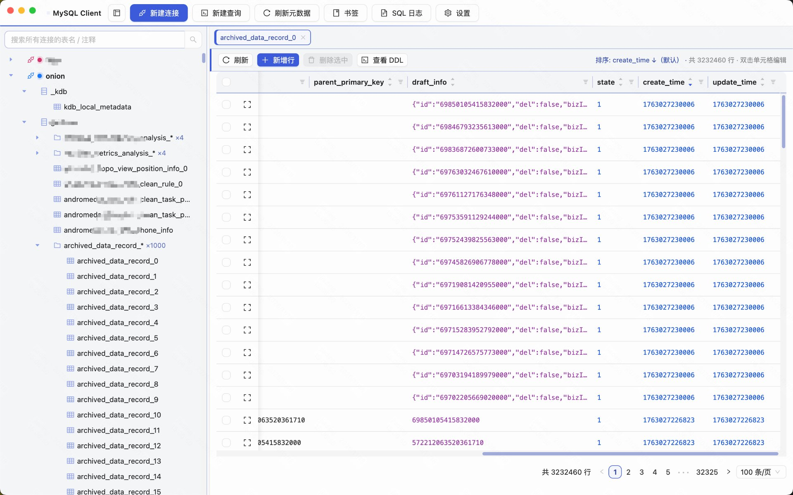

## 为什么做这个

日常开发总要和 MySQL 打交道，连的大多是测试库。一款客户端，除了基本功能，我觉得还得让人用着省事、看着顺眼，才算好工具。

前后用过 Navicat、DBeaver、SQLark，也用过 IDEA 的 MySQL 插件。每一款都有我喜欢的地方，也都有让我难受的地方。没有最好的，只有最适合自己的。

后来某次开发的时候萌生一个念头：干脆自己 vibe 一个。把各家顺手的地方拿过来，别扭的地方丢掉，只做自己想要的功能。

## 工作效率

### 表名搜索

侧栏顶部一个搜索框，输入表名或者表注释，所有连接一起找。库里上千张表的时候，不用一层层展开去翻。

### 表收藏、表标签

常用的表右键收藏，收进书签抽屉；也可以打标签分组。下次直接点开。

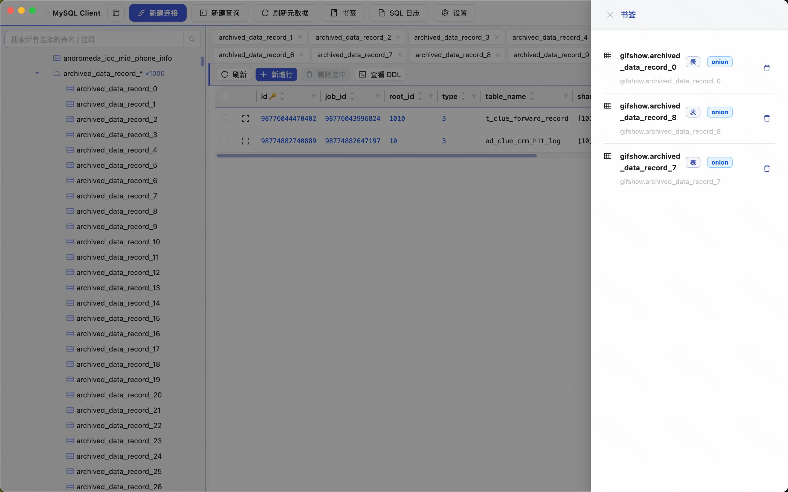

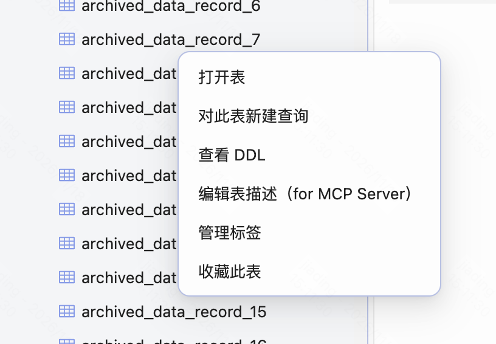

### 默认按 create_time 倒序

打开表就是最新数据在前。没有 create_time 列的退回 id 倒序，省掉每次手动点排序。这张列是索引前导列时无论多少行都排；没有索引且表超过 10 万行，会跳过默认排序避免全表排序，工具栏给提示，点列头仍可手动排。

### 时间戳自动转换

单元格里的秒级、毫秒级时间戳直接显示成日期时间，右键可以复制转换后的结果。

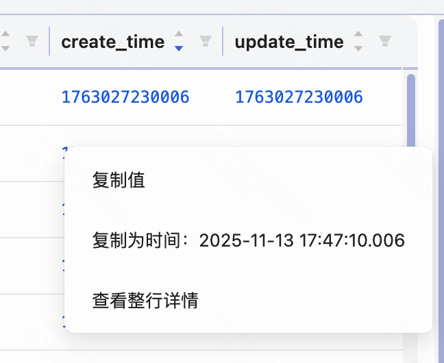

### JSON 格式化

长 JSON 悬停就能看到缩进后的结构，行详情里也能一键格式化，不用对着一整行字符串数括号。

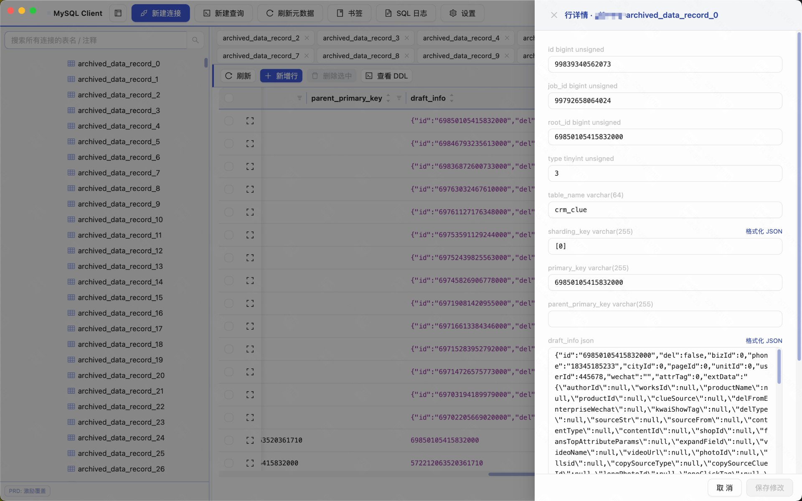

## 空间利用率

### 标签页管理

表在标签页里打开，上限可以自己设，默认 8 个。开多了自动关掉最久没用的，当前这个不动。⌘W 关的是标签页，不会把整个窗口关掉。

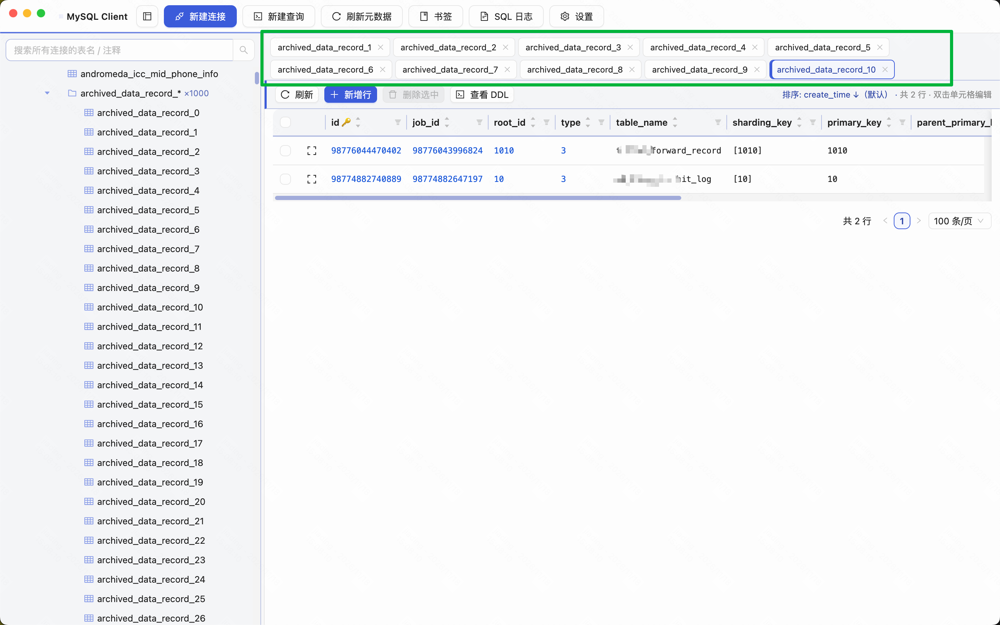

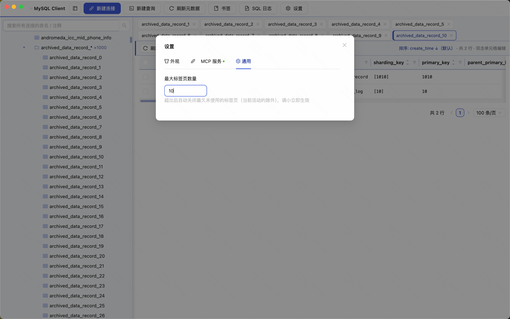

### 分表自动折叠

`order_0` 到 `order_63` 这种同前缀的数字分表，树里收成一个 `order_*`，展开才看到具体分表，按数字排序。标签打在组上整组生效，不用挨个贴。搜索 `order_17` 也能命中这个组并自动展开。开头那张主界面图里，`archived_data_record_*1000` 就是折叠后的分表组。

## 界面

主题色有 18 组预设，也能自己取色；浅色、深色、跟随系统三种模式，着色强度三档。改动即时生效，记在本地。设置里有一块实时预览，换色前能看到效果。

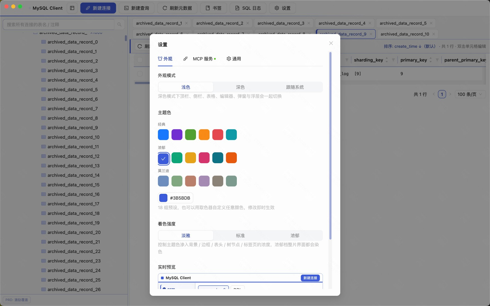

## MCP：给 AI 补上手脚

现在的开发流程里 AI 已经参与了大半：一起讨论 spec、细化 plan、拆成一个个 task 执行并自测。到提测之前，大多数活它都能自己完成，单测尤其如此。

但全流程自测还差一截。一条链路往往串着 HTTP、RPC、任务触发、MQ mock，API 调用还好，给个测试 token 就行；真正涉及中间件的地方，AI 看不见摸不着，还是得人打开界面去核对。

这个客户端连的都是测试库，正好把它通过 MCP 开放给本地 agent。于是 AI 自测时能自己去查：该 insert 的记录有没有进去、该 update 的字段改没改对、不该留的数据是不是删干净了；上线前还能看一眼测试环境的 DDL 和索引合不合适。它在开发阶段多了信息和手段，不用每一步都等我截图确认。

### 怎么用

设置 →「MCP 服务」里打开开关，复制配置进你的 MCP client。推荐 Streamable HTTP，旧版 client 用 SSE。

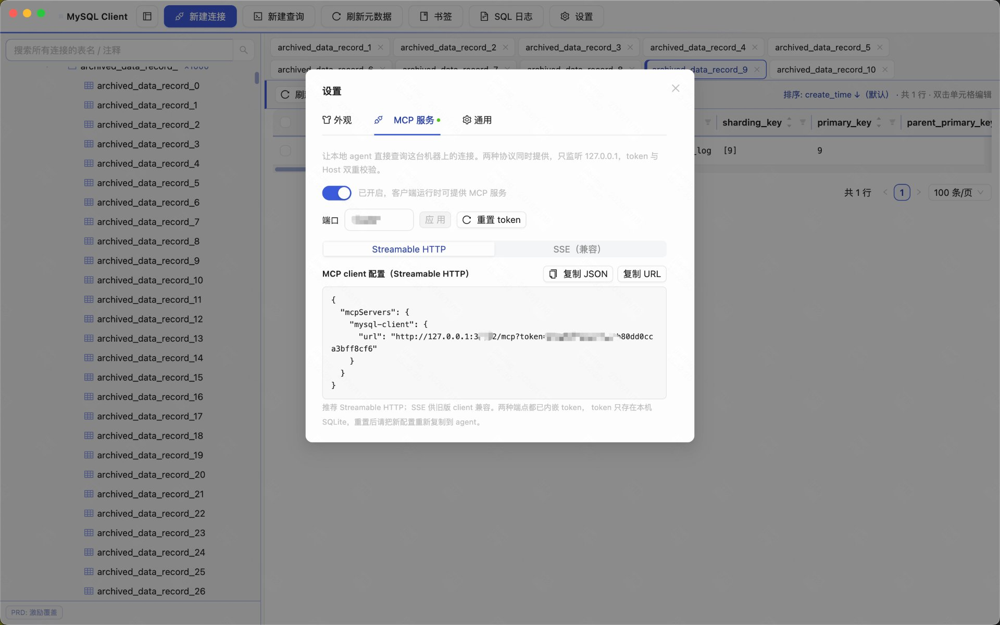

```json
{
  "mcpServers": {
    "mysql-client": {
      "url": "http://127.0.0.1:37812/mcp?token=<设置里生成>"
    }
  }
}
```

给 agent 暴露四个工具：`list_connections` 列连接、`list_tables` 列库表、`describe_table` 看字段和表说明、`query` 执行只读 SELECT（自动加 LIMIT，按连接的库表范围校验）。

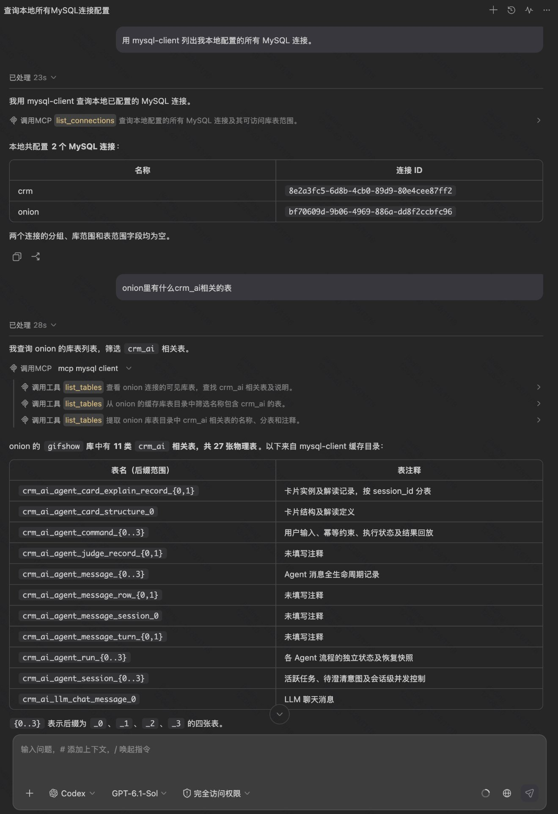

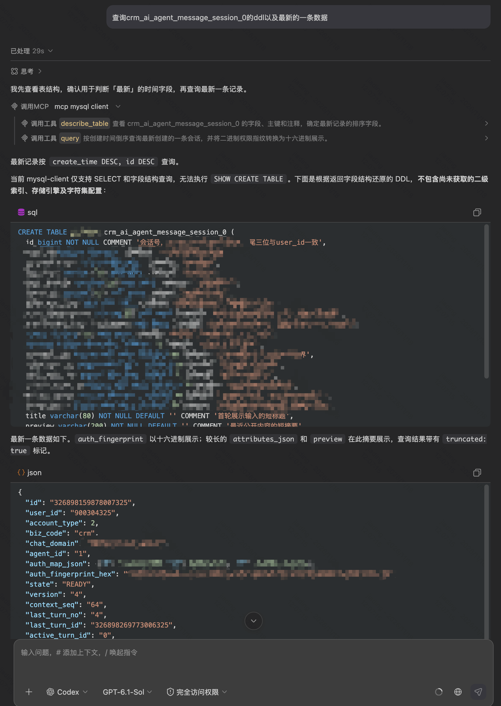

表说明在侧栏右键表或分表组填写：这张表干什么、什么场景用、存了什么。分表组写一次整组生效，agent 查表时会一并拿到。

服务只监听 127.0.0.1，token 与 Host 双重校验；写操作暂不开放。客户端关掉，MCP 也跟着下线。

## 安装与运行

需要 macOS、Node.js 20+，MySQL 5.7+ / 8.x。

```bash
git clone https://github.com/SmellyTrotter/mysql-client.git
cd mysql-client
npm install        # postinstall 会重编 better-sqlite3
npm run dev        # 开发模式
npm run dist       # 打包成未签名的 dmg
```

顶部「新建连接」填主机、端口、账号、密码，可以先测试连接；点「刷新元数据」拉取库表；然后双击表名就能看数据。密码用系统钥匙串加密后存在本地。

只调界面可以跑 `npm run dev:web`，浏览器打开 `localhost:5199`，加载的是 Mock 数据，不含真实连接信息。

## 说明

- 截图已由使用者脱敏处理，不含真实连接凭据、业务数据或个人身份信息。
- 连接配置、元数据、收藏和 SQL 日志都存在本机 SQLite（`~/Library/Application Support/mysql-client/mysql-client.db`），不上传云端。
- 没有主键的表只读，所有写操作参数化并用主键定位，删行要二次确认。
- 目前筛选一次只支持一个字段，百万行表的全表计数会偏慢；不支持 SSH 隧道；打包产物未签名。

各层职责见 [ARCHITECTURE.md](ARCHITECTURE.md)。
